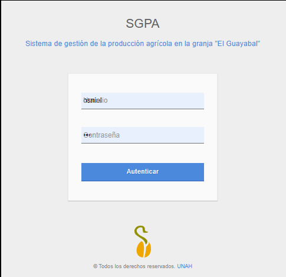
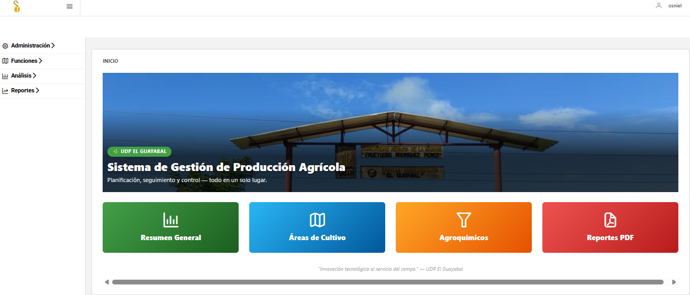
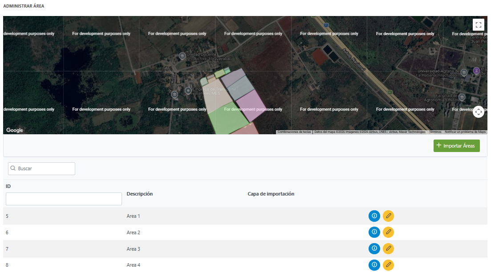
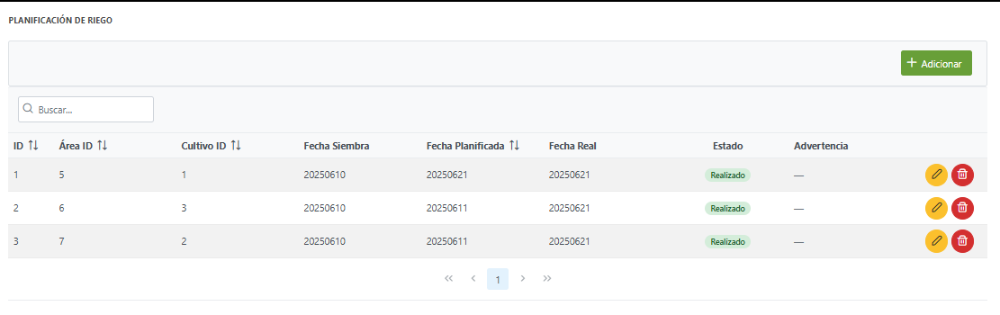
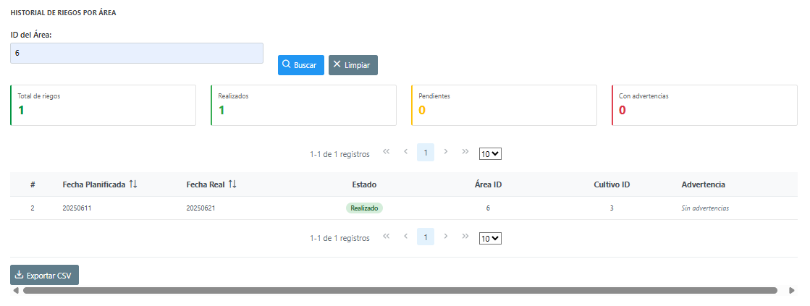
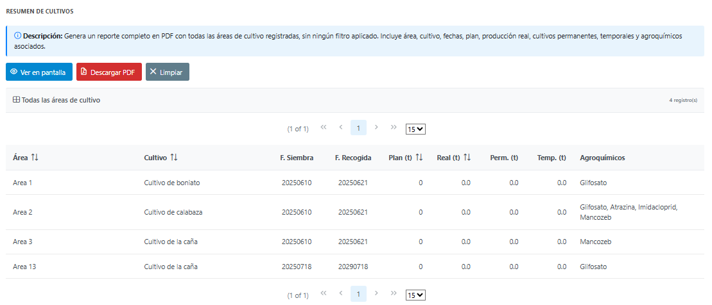

# SGPA — interfaz web

Interfaz web del **SGPA (Sistema de Gestión de la Producción Agrícola)**, una aplicación para la granja universitaria "El Guayabal" de la Universidad Agraria de La Habana (UNAH). Centraliza las áreas de cultivo, la producción, el riego, los agroquímicos, las alertas y los reportes.

Proyecto de tesis de Ingeniería Informática, **en desarrollo activo**.

Esta interfaz consume la API REST del repositorio [GuayabalSiSDE](https://github.com/osnieln/GuayabalSiSDE).

## Capturas

| Inicio de sesión | Panel principal |
|---|---|
|  |  |

**Áreas de cultivo sobre el mapa**



**Planificación e historial de riego**





**Reporte en pantalla, listo para descargar en PDF**



## Qué incluye

- **Mapa de áreas**: cada área se muestra como un polígono sobre imagen satelital, con importación desde un servicio de datos geográficos.
- **Gestión** de áreas, cultivos, tipos de cultivo, asignación de cultivos por área, producción y trabajadores.
- **Riego**: planificación e historial con filtros y exportación a CSV.
- **Agroquímicos**: catálogo y control de inventario con entradas y salidas.
- **Planificación de cosecha** con estados de seguimiento.
- **Alertas** del sistema.
- **Análisis**: resumen general con indicadores y rendimiento por área y cultivo.
- **Reportes en PDF**: resumen de cultivos, plan de producción, cultivos permanentes, fecha de recogida, cultivos por vencer y agroquímicos más usados.
- **Manual de usuario** integrado en la aplicación.

## Roles

| Rol | Acceso |
|---|---|
| Administrador | Gestión de usuarios |
| Director | Todas las funciones, análisis y reportes |
| Trabajador | Registro de producción, riego y agroquímicos |
| Técnico | Consulta de análisis y reportes |

## Tecnologías

| Capa | Herramientas |
|---|---|
| Lenguaje | Java 17 |
| Interfaz | Jakarta Faces 4 (JSF), PrimeFaces 13, Bootstrap |
| Seguridad | Spring Security |
| Servidor | WildFly 27 (Jakarta EE 10) |
| Comunicación | Cliente HTTP de Java y Jackson, contra la API REST |
| Mapas | Google Maps mediante PrimeFaces |
| Construcción | Maven (empaquetado WAR) |

## Estructura

| Paquete | Contenido |
|---|---|
| `bean` | Controladores de cada página |
| `rest` | Clientes que llaman a la API |
| `entity`, `util` | Modelos de datos y utilidades |
| `webapp/pages` | Páginas XHTML |

## Cómo ejecutarlo

**Requisitos:** Java 17, Maven, WildFly 27 y la [API](https://github.com/osnieln/GuayabalSiSDE) funcionando en `http://localhost:8081`.

1. Revisa en `src/main/webapp/WEB-INF/applicationContext.xml` los datos de conexión a PostgreSQL que usa el inicio de sesión.

2. Genera el WAR:

   ```bash
   mvn clean package
   ```

3. Copia `target/guayabal-sisde-front.war` a la carpeta `standalone/deployments` de WildFly y arranca el servidor.

4. Abre la aplicación en el navegador e inicia sesión.

## Estado

El sistema sigue creciendo como parte de la tesis. Las funciones más recientes son las alertas automáticas, la planificación de cosecha y el control de inventario de agroquímicos.

## Autores

- **Osniel Noda Cabrera** — autor principal · [github.com/osnieln](https://github.com/osnieln)
- Gabriel Alberto Pérez Guerra — colaborador
